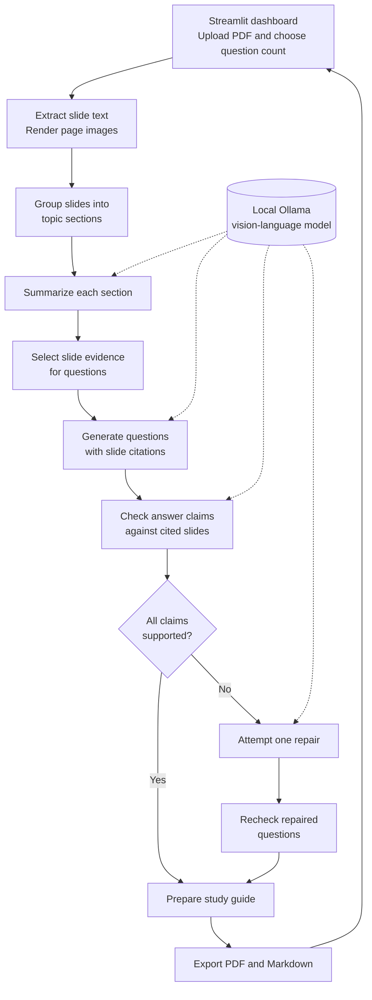

# Lecture Slides Study Agent

A local AI study tool that turns lecture PDFs into slide-cited summaries, practice questions, and a downloadable study guide. It uses a Streamlit interface and a vision-language model served by Ollama, so it can analyze slide text, images, and diagrams without a hosted AI API.

> This is a portfolio project. Model-generated content and verification can be wrong; check the cited slides before relying on the guide.

## What it does

- Extracts text from PDF slides and renders page images for visual analysis.
- Groups consecutive slides into topic sections, typically 4–7 slides, using heading cues.
- Summarizes each section with slide references.
- Generates 5, 10, 12, or 15 practice questions from selected slide evidence.
- Checks question and answer claims against cited slides, attempts one repair for unsupported claims, and rechecks the result.
- Displays summaries, questions, cited slide previews, and verification notes in a Streamlit dashboard.
- Exports a PDF study guide and a ZIP containing PDF and Markdown versions.

## How it works



The pipeline processes sections and questions sequentially. Processing time depends on deck size, model, and hardware; a full deck can take several minutes or longer.

## Technology

- Python and Streamlit
- Ollama with Qwen3-VL 4B Instruct
- PyMuPDF for PDF text extraction and page rendering
- Pydantic for structured model outputs

## Requirements

- Python 3.10 or later
- [Ollama](https://ollama.com/download), running locally
- The `qwen3-vl:4b-instruct` model, or another compatible vision model

## Run locally on Windows

Clone the repository and open its folder in VS Code:

```powershell
git clone https://github.com/osakaer/lecture-slides-study-agent.git
cd lecture-slides-study-agent
```

Install the model and Python dependencies, then start the dashboard:

```powershell
ollama pull qwen3-vl:4b-instruct
python -m venv .venv
.\.venv\Scripts\Activate.ps1
python -m pip install -r requirements.txt
streamlit run src\streamlit_app.py
```

Keep Ollama running. Open [http://127.0.0.1:8501](http://127.0.0.1:8501), upload a PDF, and start with five questions.

If PowerShell blocks virtual-environment activation, use the project interpreter directly:

```powershell
ollama pull qwen3-vl:4b-instruct
.\.venv\Scripts\python.exe -m pip install -r requirements.txt
.\.venv\Scripts\python.exe -m streamlit run src\streamlit_app.py
```

## Model settings

The default model is `qwen3-vl:4b-instruct`. Set an environment variable in the same terminal before starting Streamlit to use a different model already installed in Ollama:

```powershell
$env:OLLAMA_MODEL = "qwen3-vl:2b"
streamlit run src\streamlit_app.py
```

| Setting | Default | Purpose |
|---|---:|---|
| `OLLAMA_MODEL` | `qwen3-vl:4b-instruct` | Ollama model used for generation and verification |
| `OLLAMA_HOST` | `http://127.0.0.1:11434` | Ollama server address |
| `OLLAMA_TIMEOUT_SECONDS` | `600` | Model request timeout |
| `OLLAMA_NUM_CTX` | `16384` | Context window requested from Ollama |
| `SLIDE_DPI` | `110` | Resolution used to render PDF pages |

The app reports prompt-token usage and warns when a request is close to the configured context limit. This is a diagnostic and cannot prove that the model used every part of the input.

## Privacy and limitations

- PDFs and intermediate files are processed in a temporary folder on the same computer and removed when processing ends. The uploaded file and completed guide remain in Streamlit session memory while the results are open.
- With Ollama running locally, slide content stays on the local computer. If `OLLAMA_HOST` points to another machine or service, that server receives the model requests.
- This app is designed for local use; a public host cannot access Ollama running on each visitor's computer without a separate model-serving setup.
- The verifier is another model call, not independent proof. Check the source slides, especially for diagrams and dense technical material.
- Performance depends on available memory and CPU/GPU. Vision models can be slow on modest hardware.
- The repository does not publish benchmark results for question quality or verification accuracy.

## Project structure

```text
lecture-slides-study-agent/
├── .streamlit/config.toml  # Local server address and upload-size limit
├── src/
│   ├── streamlit_app.py    # User interface, temporary uploads, and downloads
│   ├── pipeline_worker.py  # Coordinates the processing stages
│   ├── extract.py          # Extracts text and renders slide images
│   ├── chunk.py            # Groups slides into sections
│   ├── summarize.py        # Creates cited section summaries
│   ├── questions.py        # Generates slide-grounded questions
│   ├── evidence.py         # Scores slides for question evidence
│   ├── verify.py           # Checks claims against cited slide images
│   ├── repair_questions.py # Attempts one repair for unsupported questions
│   ├── collect_questions.py
│   ├── export.py           # Produces Markdown and PDF guides
│   ├── model_provider.py   # Ollama requests and model readiness checks
│   └── models.py           # Pydantic data schemas
├── requirements.txt
└── README.md
```

## License

No license is currently included. Public visibility on GitHub does not by itself grant permission to reuse this code.
