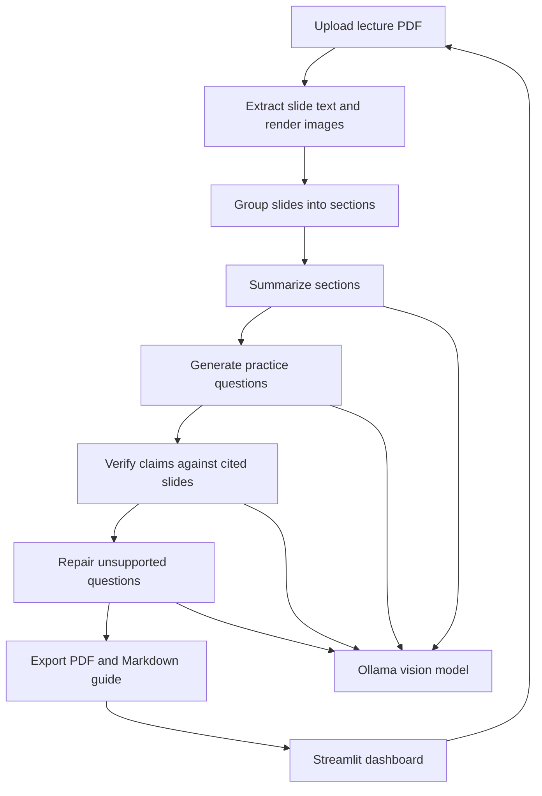

# Lecture Slides Study Agent

A local study-guide generator that turns lecture-slide PDFs into topic summaries, practice questions, and a printable guide. It uses a Streamlit dashboard and a vision-capable Ollama model to read both slide text and visual content.

> This is a portfolio and learning project. AI-generated explanations and verification results can be wrong; check the cited slides before relying on them.

## Overview

Students often need to turn a large set of lecture slides into material they can review efficiently. This app automates the first pass: it groups slides into topics, summarizes each section, creates practice questions, checks their claims against cited slides, and exports a PDF study guide.

The app runs on the student's computer. Uploaded PDFs and intermediate files are processed in a temporary local folder. No hosted account or model API key is needed.

## Features

- **Slide understanding:** Extracts PDF text and renders slide images so the vision model can consider diagrams and figures.
- **Topic-aware sections:** Groups slides using their titles and content.
- **Section summaries:** Produces concise key points with slide references.
- **Practice questions:** Creates 5, 10, 12, or 15 questions from usable slide evidence.
- **Claim-level review:** Checks question and answer claims against their cited slide, then attempts one repair pass for unsupported questions.
- **Study dashboard:** Browse section summaries, questions, verification notes, and cited slide previews.
- **Downloads:** Save the printable study guide as a PDF or download a ZIP containing the PDF and Markdown versions.
- **Local processing:** Uses Ollama on the same computer and does not require a cloud AI key.

## How it works



The pipeline handles summaries, questions, and verification sequentially. This limits the amount of slide content sent to the model in each request, but processing a full deck can take several minutes or longer depending on the model and computer.

## Evaluation

I evaluate the pipeline by hand to measure question quality, cited-slide support, verifier behavior, and the effect of automatic repair. This is a small, single-rater study; results should be treated as indicative rather than as a benchmark.

### Setup

- **Model:** `qwen3-vl:4b-instruct` through Ollama for each stage. Record the actual model and hardware used for each run.
- **Decks and subjects:** Not reported yet.
- **Questions:** 12 per deck in the evaluation runner. Record the total number rated.
- **Rater:** Single rater. The rating sheet shuffles rows and keeps verifier verdicts and question versions in a separate key file to support blind review.
- **Rubric:** Add the fixed rubric at `eval/RUBRIC.md` before publishing results; this file is not currently in the repository.
- **Code version and run date:** Record the commit hash and date used for the evaluation.

### Results

Completed ratings and measurements are not present in this repository, so no scores are reported here yet. Fill in the tables after running the evaluation; do not replace these pending values with estimates.

**First-pass question quality** (n = pending)

| Metric | Result |
|---|---:|
| Relevant | Pending |
| Trivial | Pending |
| Wrong | Pending |
| Cited slide fully supports the answer | Pending |
| Cited slide partly supports the answer | Pending |
| Cited slide does not support the answer | Pending |

**Verifier compared with human ratings**

| Measure | Result |
|---|---:|
| Verifier said “yes” when human rated support partial/no (miss rate) | Pending |
| Human rated support partial/no and verifier did not say “yes” (catch rate) | Pending |
| Verifier flagged an answer the human rated fully supported (false-alarm rate) | Pending |

**Effect of repair**

| Measure | Result |
|---|---:|
| Human support ratings improved / stayed the same / worsened | Pending |
| Rated trivial before → after repair | Pending |
| Verifier “yes” after repair vs. human “yes” | Pending |

The last two comparisons are available in the paired rows of `eval/ratings.csv` and `eval/key.csv`, but `eval/compute_results.py` does not currently print them as summary metrics.

**Findings:** Add the main measured result after ratings are complete.

**Failure cases:** Add a few paraphrased examples, such as a diagram-heavy slide that led to a mistaken label reading, and whether the verifier caught it. Do not include copyrighted slide text.

### Reproduce the evaluation

1. Put 3 to 5 representative lecture PDFs in `eval/decks/`.
2. Run the full pipeline, which generates 12 questions for each deck:

   ```powershell
   python eval/run_all.py
   ```

3. Generate the shuffled human-rating sheet:

   ```powershell
   python eval/make_rating_sheet.py
   ```

4. Fill in `relevance` (`relevant`, `trivial`, or `wrong`) and `slide_supports` (`yes`, `partial`, or `no`) in `eval/ratings.csv`. Keep `eval/key.csv` closed until ratings are complete.
5. Calculate question-quality, verifier, and repair summaries:

   ```powershell
   python eval/compute_results.py
   ```

The scripts calculate first-pass quality, verifier misses/catches/false alarms, and paired repair support changes. The PDFs, generated runs, and rating files are local and excluded from Git. Rerunning a deck replaces its previous evaluation output under `data/runs/evaluation/`.

## Technology

- Python
- Streamlit
- Ollama
- Qwen3-VL (vision-language model)
- PyMuPDF for PDF text extraction and slide rendering
- Pydantic for structured model output

## Requirements

- Windows, macOS, or Linux
- Python 3.10 or later
- [Ollama](https://ollama.com/download) installed and running
- A vision model available in Ollama

The code defaults to `qwen3-vl:2b`. To use the `qwen3-vl:4b-instruct` model used for this project, download it with:

```powershell
ollama pull qwen3-vl:4b-instruct
```

Larger models can produce stronger results but need more memory and may run more slowly. Set `OLLAMA_MODEL` in the same terminal before starting the dashboard.

## Run locally on Windows

Open the project folder in VS Code, then use its PowerShell terminal:

```powershell
python -m venv .venv
.\.venv\Scripts\Activate.ps1
python -m pip install -r requirements.txt
$env:OLLAMA_MODEL = "qwen3-vl:4b-instruct"
streamlit run src\streamlit_app.py
```

Keep Ollama running. Streamlit opens the dashboard at [http://127.0.0.1:8501](http://127.0.0.1:8501). Upload a small PDF and begin with 5 questions to confirm the setup.

If virtual-environment activation is blocked, use the project interpreter directly:

```powershell
& .\.venv\Scripts\python.exe -m pip install -r requirements.txt
$env:OLLAMA_MODEL = "qwen3-vl:4b-instruct"
& .\.venv\Scripts\python.exe -m streamlit run src\streamlit_app.py
```

### Select another installed Ollama model

The project examples use `qwen3-vl:4b-instruct`. To choose a different installed model, set `OLLAMA_MODEL` in the same terminal before launching Streamlit. For example:

```powershell
$env:OLLAMA_MODEL = "qwen3-vl:2b"
streamlit run src\streamlit_app.py
```

Ollama must have the exact model name installed. Check available models with `ollama list`.

The default Ollama address is `http://127.0.0.1:11434`. Set `OLLAMA_HOST` to use another address. Model requests time out after 600 seconds by default; set `OLLAMA_TIMEOUT_SECONDS` to change that limit.

## Privacy and limitations

- The app does not request or store an AI API key.
- The PDF, rendered slides, and model requests stay on the local computer when Ollama is running locally.
- Temporary working copies and intermediate pipeline files are deleted when processing ends. Streamlit may keep the uploaded file buffered in session memory until the session ends. The completed guide and cited slide previews also stay in session memory while the results are open; they are not written to a persistent project folder.
- Processing speed depends on the model, CPU/GPU, and available memory. Vision models can be slow on computers with limited resources.
- Verification is model-assisted, not proof. Review the source slides, especially for diagrams and dense technical material.
- The app is designed for local use. A public host cannot connect to Ollama running on a user's computer without a separate model-serving architecture.

## Project structure

```text
lecture-agent/
├── .streamlit/
│   └── config.toml       # Local address and upload-size limit
├── README.md
├── requirements.txt
└── src/
    ├── streamlit_app.py  # Dashboard and temporary upload workflow
    ├── pipeline_worker.py
    ├── extract.py        # Text extraction and slide image rendering
    ├── chunk.py          # Title-aware slide grouping
    ├── summarize.py
    ├── questions.py
    ├── collect_questions.py
    ├── verify.py
    ├── repair_questions.py
    ├── export.py
    ├── model_provider.py # Local Ollama client
    ├── models.py         # Data schemas
    └── evidence.py
```

## License

This repository does not currently include a license. Public visibility on GitHub does not by itself grant permission to reuse the code.
