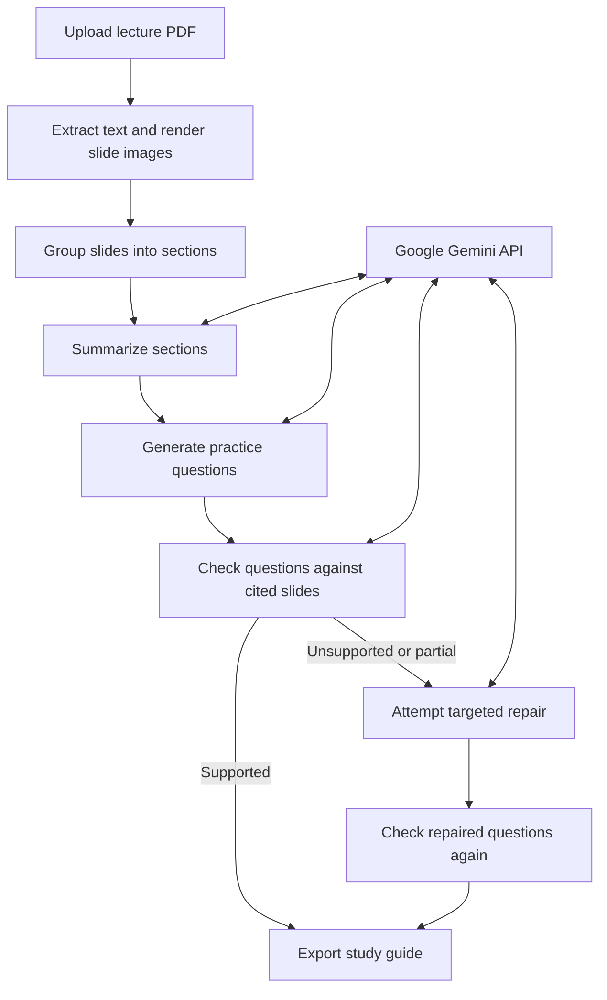

# Lecture Slides Study Agent

Turn a lecture PDF into a study guide with topic summaries, practice questions, cited slides, and a printable PDF. The web app accepts a Google Gemini API key for each run and keeps uploaded files and generated results temporary.

> This is a portfolio project and an educational aid. Model-generated summaries, questions, and verification results can be wrong; check the cited slides before relying on them.

## What it does

- Extracts slide text and renders each PDF page so diagrams and other visual material can be considered.
- Groups slides into topical sections and generates summaries with slide references.
- Creates 10, 12, or 15 practice questions from the uploaded deck.
- Checks each question against its cited slide, attempts a targeted repair for unsupported questions, and checks repaired results again.
- Lets you browse summaries, questions, verification notes, and cited slide images in the browser.
- Exports a printable PDF and Markdown study guide together in a ZIP download.

## How it works



The browser app starts an isolated Python worker for each upload. The worker runs the pipeline stages and writes intermediate files to a temporary job directory. Job progress and ownership are tracked in server memory.

## Deploy on Render

Deploy this project as a Python web service on Render. Each person enters their own Google Gemini API key in the web page when creating a guide; you do not configure a shared Gemini key on the host.

### Requirements

- A GitHub repository containing this project.
- A Render account connected to GitHub.
- Python 3.10 or later (Render installs Python and the packages from requirements.txt).

### Render setup

1. In the Render dashboard, select **New > Web Service** and connect the GitHub repository.
2. Leave **Root Directory** blank and choose the Python runtime.
3. Set the **Build Command** to:

    pip install -r requirements.txt

4. Set the **Start Command** to:

    python src/web_app.py

5. Choose the **Free** instance for a portfolio demo.
6. In **Environment**, add HOST with the value 0.0.0.0. Render supplies PORT automatically, and the app reads it. Do not add your personal Gemini API key to Render.
7. Select **Create Web Service**. When deployment finishes, open the onrender.com address shown in the Render dashboard.

Render can redeploy when you push changes to the connected GitHub branch. The free service sleeps after 15 minutes without traffic and can take about a minute to wake. Its filesystem is temporary, so a restart or sleep can interrupt jobs and remove their files. Check [Render's free-service limits](https://render.com/docs/free) and use a small, non-sensitive PDF for the first live test.

Optional Gemini model settings can be entered in the Render service Environment page:

    GEMINI_MODEL=gemini-3.8-flash
    GEMINI_THINKING_LEVEL=low

The model must be available to the user's Google AI account. Thinking level can be low, medium, or high.

## Use the web app

1. Choose a PDF from your device.
2. Select 10, 12, or 15 practice questions.
3. Enter your Gemini API key for this run.
4. Start the guide and follow the progress panel.
5. Open **Current guide** to review summaries, questions, verification notes, and cited slides.
6. Download the ZIP containing `study_guide.pdf` and `study_guide.md`.

The current upload limit is 50 MB, and the server accepts up to two active jobs at a time. These limits are intended for a small demo, not high-volume use.

## Temporary files and privacy

- The PDF, rendered slide images, intermediate results, and generated guides are stored temporarily on the app server while a job runs.
- The app removes completed job files after download or after about 29 minutes. Failed jobs are cleaned up when processing ends.
- A server restart clears in-memory job state and can interrupt active jobs or remove results before download.
- The API key is submitted to the app over HTTPS and passed to the worker process for that run. Do not use a key you are not authorized to use.
- Slide text and relevant slide images are sent to the Google Gemini API during generation and verification. Review Google's terms and privacy information before uploading sensitive or restricted course material.
- Application cleanup is not a promise of forensic erasure from operating-system or hosting-provider infrastructure.

### Vercel status

The current app is not designed to run directly as Vercel Functions. It depends on a long-running Python worker, temporary local files, and in-memory job tracking. A Vercel deployment would need a separate Python worker, private temporary file storage, and shared job status/queue infrastructure. Vercel Functions also have a 4.5 MB request-body limit, so PDFs would need to upload directly from the browser to storage instead of passing through a function. See [Vercel Function limits](https://vercel.com/docs/functions/limitations) and [Vercel Blob client uploads](https://vercel.com/docs/vercel-blob/client-upload).

## Architecture

| Component | Responsibility |
| --- | --- |
| `src/web_app.py` | Serves the web UI and handles uploads, sessions, job status, slide previews, and downloads. |
| `src/web_jobs.py` | Starts pipeline workers, tracks job progress, and cleans up temporary workspaces. |
| `src/pipeline_worker.py` | Runs the processing stages for one uploaded PDF. |
| `src/extract.py` | Extracts slide text and renders slide images with PyMuPDF. |
| `src/chunk.py` | Groups slides into sections. |
| `src/summarize.py` | Generates cited section summaries. |
| `src/evidence.py` | Scores slide text to help select evidence-rich slides. |
| `src/questions.py` | Generates a question candidate from a section and slide evidence. |
| `src/collect_questions.py` | Collects question candidates into the selected set. |
| `src/verify.py` | Checks question claims against cited slide text and images. |
| `src/repair_questions.py` | Attempts a targeted repair for unsupported questions. |
| `src/export.py` | Creates the Markdown and PDF study guides. |
| `src/models.py` | Defines shared structured-data schemas. |
| `src/model_provider.py` | Configures and calls the Google Gemini API. |
| `src/static/index.html` | Contains the browser interface, styles, and client-side behavior. |

## Limitations

- Verification is model-assisted, not a formal proof. A verifier can miss unsupported claims or approve an incorrect answer.
- Image quality, small text, complex diagrams, and scanned slides can reduce extraction or verification quality.
- Gemini availability, request speed, and quotas depend on Google's service and the user's account.
- The app uses in-memory job tracking and one server process. It is not configured for horizontal scaling or durable background jobs.
- The public deployment steps are for a low-traffic demo. This repository does not include production-grade identity, rate limiting, or a durable queue.

## Project structure

```text
lecture-agent/
├── .gitignore
├── README.md
├── requirements.txt
└── src/
    ├── chunk.py
    ├── collect_questions.py
    ├── evidence.py
    ├── export.py
    ├── extract.py
    ├── model_provider.py
    ├── models.py
    ├── pipeline_worker.py
    ├── questions.py
    ├── repair_questions.py
    ├── summarize.py
    ├── verify.py
    ├── web_app.py
    ├── web_jobs.py
    └── static/
        └── index.html
```

## Technology

- Python and the standard-library `ThreadingHTTPServer`
- PyMuPDF for PDF text extraction, page rendering, and PDF export
- Google GenAI SDK for Gemini
- Pydantic for structured model responses
- HTML, CSS, and vanilla JavaScript

## License

This repository does not currently include a license file. Unless a license is added, reuse is not granted by the repository's public visibility alone.
