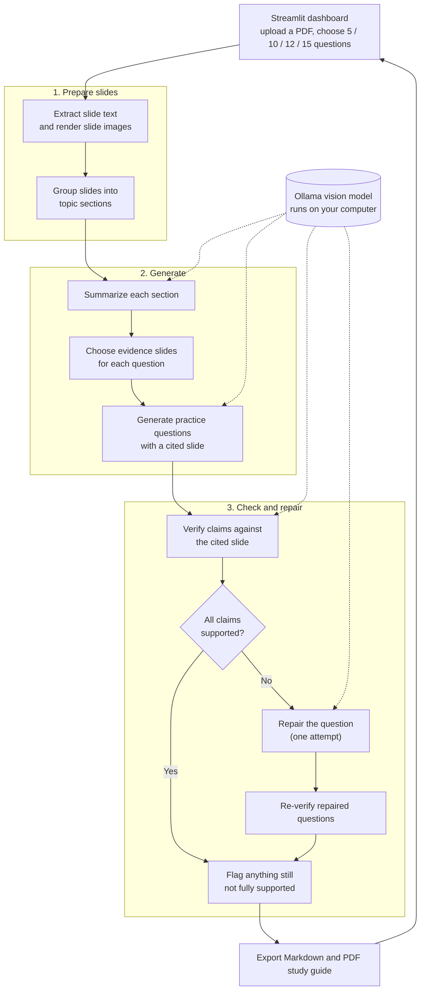

# Lecture Slides Study Agent

A local study-guide generator that turns lecture-slide PDFs into topic summaries, practice questions, and a printable guide. It uses a Streamlit dashboard and a vision-capable Ollama model to read both slide text and visual content.

> This is a portfolio and learning project. AI-generated explanations and verification results can be wrong; check the cited slides before relying on them.

## Overview

Students often need to turn a large set of lecture slides into material they can review efficiently. This app automates the first pass: it groups slides into topics, summarizes each section, creates practice questions, checks their claims against cited slides, and exports a PDF study guide.

The app runs on the student's computer. Uploaded PDFs and intermediate files are processed in a temporary local folder. No hosted account or model API key is needed.

## Features

- **Slide understanding:** Extracts PDF text and renders slide images so the vision model can consider diagrams and figures.
- **Topic-aware sections:** Groups slides using their titles and content.
- **Section summaries:** Produces concise key points with slide references.
- **Practice questions:** Creates 5, 10, 12, or 15 questions from usable slide evidence.
- **Claim-level review:** Checks question and answer claims against their cited slide, then attempts one repair pass for unsupported questions.
- **Study dashboard:** Browse section summaries, questions, verification notes, and cited slide previews.
- **Downloads:** Save the printable study guide as a PDF or download a ZIP containing the PDF and Markdown versions.
- **Local processing:** Uses Ollama on the same computer and does not require a cloud AI key.

## How it works



The pipeline handles summaries, questions, and verification sequentially. This limits the amount of slide content sent to the model in each request, but processing a full deck can take several minutes or longer depending on the model and computer.

## Technology

- Python
- Streamlit
- Ollama
- Qwen3-VL (vision-language model)
- PyMuPDF for PDF text extraction and slide rendering
- Pydantic for structured model output

## Requirements

- Windows, macOS, or Linux
- Python 3.10 or later
- [Ollama](https://ollama.com/download) installed and running
- A vision model available in Ollama

The code defaults to `qwen3-vl:4b-instruct`. Download it with:

```powershell
ollama pull qwen3-vl:4b-instruct
```

Larger models can produce stronger results but need more memory and may run more slowly. Set `OLLAMA_MODEL` in the same terminal before starting the dashboard.

## Run locally on Windows

Open the project folder in VS Code, then use its PowerShell terminal:

```powershell
python -m venv .venv
.\.venv\Scripts\Activate.ps1
python -m pip install -r requirements.txt
$env:OLLAMA_MODEL = "qwen3-vl:4b-instruct"
streamlit run src\streamlit_app.py
```

Keep Ollama running. Streamlit opens the dashboard at [http://127.0.0.1:8501](http://127.0.0.1:8501). Upload a small PDF and begin with 5 questions to confirm the setup.

If virtual-environment activation is blocked, use the project interpreter directly:

```powershell
& .\.venv\Scripts\python.exe -m pip install -r requirements.txt
$env:OLLAMA_MODEL = "qwen3-vl:4b-instruct"
& .\.venv\Scripts\python.exe -m streamlit run src\streamlit_app.py
```

### Select another installed Ollama model

The project examples use `qwen3-vl:4b-instruct`. To choose a different installed model, set `OLLAMA_MODEL` in the same terminal before launching Streamlit. For example:

```powershell
$env:OLLAMA_MODEL = "qwen3-vl:2b"
streamlit run src\streamlit_app.py
```

Ollama must have the exact model name installed. Check available models with `ollama list`.

The default Ollama address is `http://127.0.0.1:11434`. Set `OLLAMA_HOST` to use another address. Model requests time out after 600 seconds by default; set `OLLAMA_TIMEOUT_SECONDS` to change that limit.

## Privacy and limitations

- The app does not request or store an AI API key.
- The PDF, rendered slides, and model requests stay on the local computer when Ollama is running locally.
- Temporary working copies and intermediate pipeline files are deleted when processing ends. Streamlit may keep the uploaded file buffered in session memory until the session ends. The completed guide and cited slide previews also stay in session memory while the results are open; they are not written to a persistent project folder.
- Processing speed depends on the model, CPU/GPU, and available memory. Vision models can be slow on computers with limited resources.
- Verification is model-assisted, not proof. Review the source slides, especially for diagrams and dense technical material.
- The app is designed for local use. A public host cannot connect to Ollama running on a user's computer without a separate model-serving architecture.

## Project structure

```text
lecture-agent/
├── .streamlit/
│   └── config.toml       # Local address and upload-size limit
├── README.md
├── requirements.txt
└── src/
    ├── streamlit_app.py  # Dashboard and temporary upload workflow
    ├── pipeline_worker.py
    ├── extract.py        # Text extraction and slide image rendering
    ├── chunk.py          # Title-aware slide grouping
    ├── summarize.py
    ├── questions.py
    ├── collect_questions.py
    ├── verify.py
    ├── repair_questions.py
    ├── export.py
    ├── model_provider.py # Local Ollama client
    ├── models.py         # Data schemas
    └── evidence.py
```

## License

This repository does not currently include a license. Public visibility on GitHub does not by itself grant permission to reuse the code.
